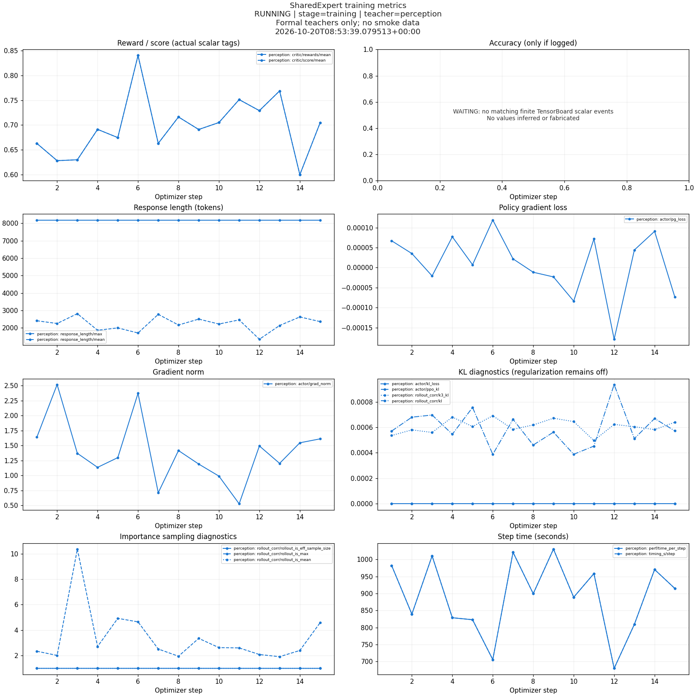

# SharedExpert / CVPR2027

围绕 SharedExpert 与多教师 on-policy distillation（MOPD）的论文设计和多模态训练实验。截至 2026-10-26，基座、感知 v1、推理、通用及感知 v2 五个 4B 模型均已完成三套评测，每模型 7,162 题。新的六项高分辨率感知子集评测单独运行，使用不同的图像预算，成绩不与旧套件混合。

## 最新评测资料

- [五模型结果与诊断快照](reproducibility/evaluation_20261026/README.md)：完整成绩、IFEval 敏感性分析，以及推理教师感知能力诊断。
- [高分辨率感知评测](experiments/sharedexpert_c/evaluation/highres/README.md)：四模型、六项感知子集、每模型 24,461 题；原图上限 33,554,432 像素。
- [高分辨率运行状态快照](reproducibility/evaluation_20261026/highres/status_snapshot.json)：带时间戳的静态进度，不是实时监控或已完成成绩。
- [项目执行约定](AGENTS.md)：新训练先做 CPU 配置、数据、依赖和资源检查，然后直接启动已授权的正式训练；不默认安排独立 GPU smoke。

## 项目入口

- [初始论文骨架](SharedExpert_MOPD_论文骨架.md)
- [候选方案与修订骨架](SharedExpert_MOPD_候选方案与修订骨架.md)
- [数学审查](SharedExpert_MOPD_数学审查.md)
- [文献核验](SharedExpert_MOPD_文献核验.md)
- [方法与实验审查](SharedExpert_MOPD_方法与实验审查.md)
- [训练配置、数据与可验证奖励](experiments/sharedexpert_c/docs/训练配置与可验证奖励.md)
- [搭建问题复盘](experiments/sharedexpert_c/docs/搭建问题复盘.md)
- [评测配置与问题记录](experiments/sharedexpert_c/docs/评测配置与问题记录.md)

## 三教师训练配置记录

| 项目 | 设置 |
|---|---|
| 教师 / 后续学生基座 | Qwen3.5-4B |
| 感知教师 | TallyQA : CLEVR : RefCOCO = 4 : 4 : 2 |
| 推理教师 | Geometry3K train : MMK12 : ViRL39K = 4 : 2 : 4 |
| 通用教师 | VQA : 文档图表 : 推理 : 感知 : IF = 40 : 10 : 20 : 20 : 10 |
| 每教师预算 | 100 steps，prompt batch 30，group 8 |
| 长度上限 | prompt 2048，response 8192 |
| RL | GRPO，KL / entropy 关闭，LR 1e-6 |
| 分布式 | 4 GPU，FSDP2，单序列 microbatch 1 |
| checkpoint | 每 25 steps 保存，保留最近 2 个 |

每个教师原 prepared 数据为 12,000 行，batch 30 协议依顺序使用前 3,000 行，共 24,000 次响应采样。基础参数见 [common.json](experiments/sharedexpert_c/training/config/common.json)；有效终点由 [execution_budget.json](experiments/sharedexpert_c/training/config/execution_budget.json) 覆盖为 100。上表保留原三教师配置，实际服务器续跑配置以各次运行记录为准；新增感知 v2 不应套用 v1 的数据配比。此次评测使用最终 step100 HF 导出。

## 目录

```text
SharedExpert_MOPD_*.md          论文设计与审查
experiments/sharedexpert_c/
  training/                    训练入口、环境构建、验证与配置
  data_pipeline/               数据获取、构建、清洗与审计
  evaluation/                  固定评测套件构建、推理和评分
  docs/                        训练、搭建和评测文档
  tests/                       奖励测试
  logs/                        小型配置、环境版本、审计记录和辅助脚本
  runtime/                     仅跟踪明确列出的历史验收凭据
  monitor_training.py          OOM 监控和训练曲线
  run_experiment.py            三教师训练与评测编排
pre-lab/                       前期模型、评测与感知探针脚本
  repo/                        Vision-OPD 子模块
  vlmevalkit/                   VLMEvalKit 子模块
reproducibility/               依赖版本、源码补丁和历史指标快照
```

## 获取完整源码和依赖修改

```bash
git clone --recurse-submodules https://github.com/aiiseverything/CVPR2027.git
cd CVPR2027
python3 reproducibility/restore_dependencies.py
python3 reproducibility/restore_dependencies.py --check
```

两个第三方仓库均锁定到精确 commit；本地修改完整保存在 [patches](reproducibility/patches)，版本与补丁 SHA-256 见 [dependencies.json](reproducibility/dependencies.json)。恢复脚本拒绝覆盖其他未提交修改。子模块设置 `ignore=dirty`，因为应用这些记录在案的补丁后，其工作树会有预期修改；请用上述 `--check` 核验，而非仅看顶层 `git status`。

## 环境、数据和运行

依次阅读：

1. [训练环境与入口](experiments/sharedexpert_c/training/README.md)：独立虚拟环境、FlashAttention 构建、CPU/GPU 检查及启动。
2. [数据准备](experiments/sharedexpert_c/data_pipeline/README.md)：来源、配比、去重与评测集泄漏检查。
3. [评测入口](experiments/sharedexpert_c/evaluation/README.md)：固定套件与严格评分规则。
4. [监控入口](experiments/sharedexpert_c/monitoring/README.md)：独立后台监控、OOM 告警、TensorBoard 指标和图表。

原实验工作区为 `/home/ml-user/workdir/CVPR2027`，当前运行工作区位于挂载盘。部分历史脚本和凭据包含旧绝对路径、GPU 与端口布局，换机器时须核对环境、模型路径和数据完整性。新训练遵循 [AGENTS.md](AGENTS.md) 的 CPU 检查与直接正式运行流程；历史成功凭据不能代替新机器的检查。

## 数据与运行产物

本次新增资料包含代码、配置、小型审计摘要和结果快照；已有历史提交中的预测记录继续保留。以下大体积产物不新增到 Git，由 `.gitignore` 排除：

- 模型权重、checkpoint、优化器状态和虚拟环境；
- 下载数据、图片、parquet / TSV、评测题目与逐样本生成内容；
- 原始服务日志、进程环境、PID、运行锁、Ray/vLLM 缓存和持续增长的监控采样。

数据和模型请通过项目脚本从原始来源获取，并遵循各自使用条款。第三方源码遵循对应子模块中的许可；本仓库未额外指定项目许可证。

[2026-10-20 历史快照](reproducibility/snapshot_20261020/snapshot.json) 保留当时的训练步数、指标哈希、曲线和 baseline 汇总。已完成的教师评测以 [2026-10-26 资料快照](reproducibility/evaluation_20261026/README.md) 为准；早期 reward 和旧 baseline 图表不代表最终教师成绩。旧故障和未通过的尝试仍保留在复盘文档。


